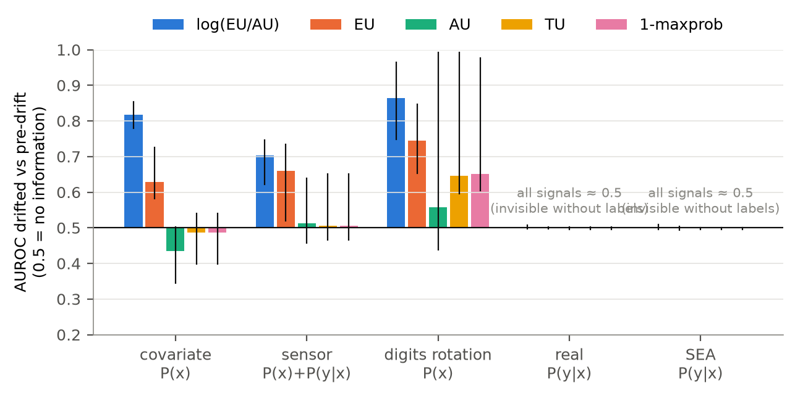
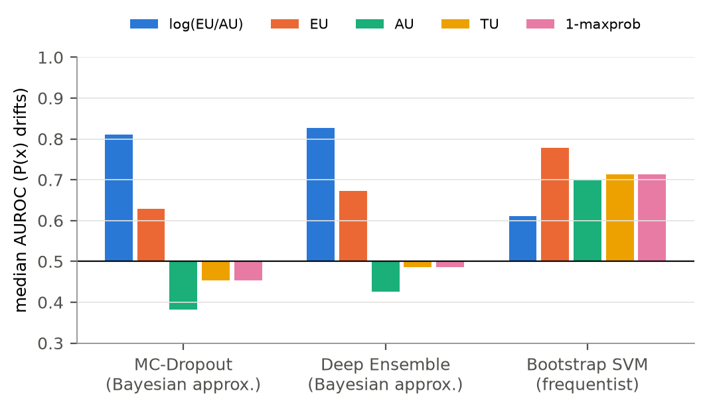
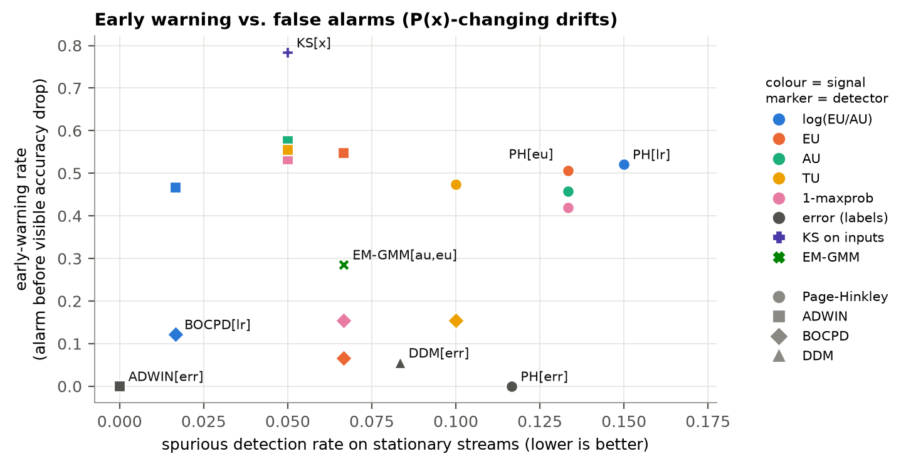
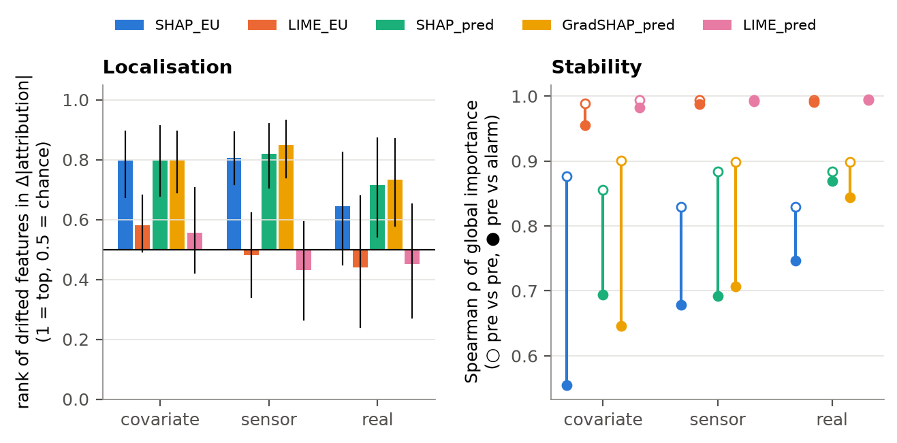
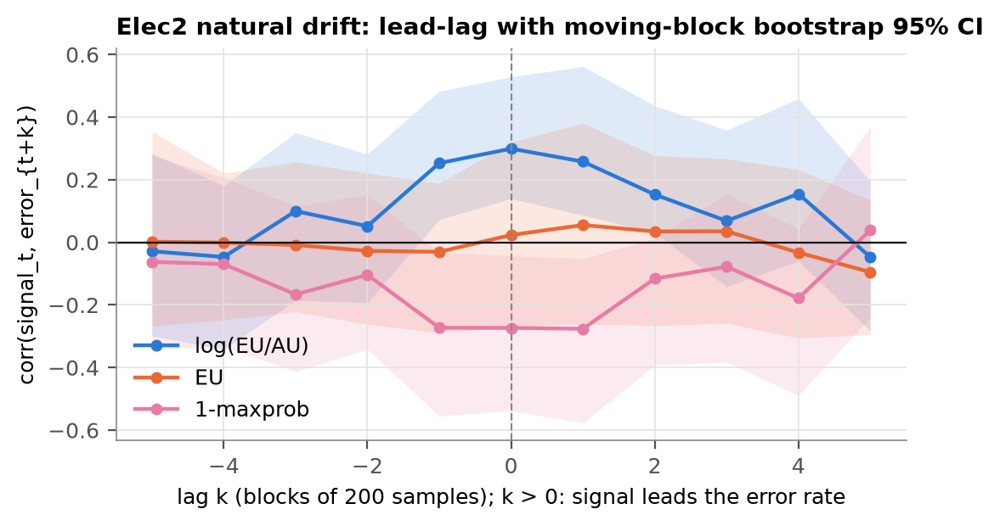

**Rezumat.** Detectoarele clasice de deviere conceptuală (DDM, ADWIN, Page-Hinkley) monitorizează rata de eroare a modelului, deci au nevoie de etichete și reacționează abia după ce acuratețea a scăzut. Studiem dacă incertitudinea modelului, calculată numai din intrări, poate da o alarmă mai devreme și, mai ales, *ce componentă* a incertitudinii este utilă. Descompunem entropia predictivă a unor clasificatori probabiliști (MLP cu MC-Dropout, ansamblu profund, ansamblu bootstrap de SVM-uri) în incertitudine aleatorică (AU) și epistemică (EU, informația mutuală) și propunem ca semnal de monitorizare raportul $\log(EU/AU)$. Pe 225 de fluxuri semi-sintetice construite din date reale (credit, churn, cifre scrise de mână) și sintetice (SEA), cu moment de deviere cunoscut, plus fluxul natural Elec2, testăm cinci ipoteze formulate înainte de analiză. (H2) Raportul separă datele deviate de cele de referință mai bine decât EU, AU, entropia totală sau $1-\max p$ (AUROC median 0,80 față de 0,67 pentru EU; toate comparațiile semnificative după corecția Holm). (H5) Avantajul există însă doar pentru rețelele neuronale bayesiene aproximative; pentru SVM-ul bootstrap (frecventist) se inversează. Explicăm mecanismul: rețelele ReLU devin supra-încrezătoare departe de datele de antrenare, deci AU scade în timp ce EU crește, iar SVM-ul cu nucleu RBF revine la probabilitatea a priori, deci ambele cresc. (H1) Alarma fără etichete vine semnificativ mai devreme decât detectoarele supervizate, dar precede scăderea *vizibilă* a acurateței doar în 51 % din cazuri (avans median 30 de eșantioane, $p_{Holm}=0{,}24$). Ipoteza avertizării timpurii nu este deci confirmată în forma ei tare. (H3) Sub deviere pură a lui $P(y\mid x)$, toate semnalele de incertitudine sunt echivalente statistic cu hazardul (TOST, $p<0{,}001$), cum prezice o propoziție simplă pe care o demonstrăm. (H4) Atribuirile KernelSHAP și GradientSHAP ale EU pe eșantioanele de alarmă indică trăsăturile care au deviat cu adevărat (rang normalizat 0,78–0,92), iar LIME nu reușește acest lucru. Pe fluxul natural Elec2, raportul variază împreună cu eroarea ($r=0{,}30$) fără a o anticipa, iar testul KS pe intrări alarmează de peste 20 de ori mai des. Codul, datele verificate prin SHA-256 și o aplicație interactivă permit reproducerea integrală.

**Cuvinte cheie:** deviere conceptuală; incertitudine epistemică; MC-Dropout; inferență bayesiană; detecție fără etichete; SHAP; LIME; MLOps.

# 1. Introducere

Un model de învățare automată este antrenat o dată, pe date istorice, și apoi pus în producție. Lumea în care funcționează se schimbă: apar segmente noi de clienți, un senzor își pierde calibrarea, fraudatorii își modifică tacticile. Formal, distribuția comună $P_t(x,y)=P_t(x)\,P_t(y\mid x)$ depinde de timp. Fenomenul se numește *deviere conceptuală* (*concept drift*) [@gama2014; @lu2019].

Metodele standard de detecție urmăresc rata de eroare a modelului și declanșează o alarmă când aceasta crește semnificativ: DDM [@gama2004], ADWIN [@bifet2007] și Page-Hinkley [@page1954]. Au două dezavantaje practice. Primul: au nevoie de eticheta reală a fiecărei predicții, iar în creditare eticheta „neplată” apare după luni, în fraudă după o contestație, în mentenanța predictivă după defectare. Al doilea: prin construcție reacționează după ce eroarea a crescut, adică după ce afacerea a plătit deja costul.

O alternativă este să privim modelul însuși. Un model bayesian „știe ce nu știe”. Incertitudinea lui predictivă poate fi separată în incertitudine *aleatorică* (zgomot ireductibil în date, suprapunerea claselor) și *epistemică* (ignoranța modelului, care scade cu mai multe date) [@kendall2017; @depeweg2018; @hullermeier2021]. Intuiția este că, atunci când intrările se îndepărtează de datele de antrenare, crește componenta epistemică, *înainte* ca greșelile să devină vizibile în statistici.

**Lucrarea cea mai apropiată și ce aducem nou.** Baier et al. [-@baier2023] au propus *Uncertainty Drift Detection* (UDD). Ei monitorizează cu ADWIN incertitudinea *totală* a unei rețele MC-Dropout, fără etichete. Lucrarea de față pornește de la UDD și aduce cinci contribuții. Nu le-am găsit combinate în literatura consultată.

1. **Semnalul descompus.** Monitorizăm raportul $\log(EU/AU)$ și îl comparăm direct cu componentele lui (EU, AU, entropia totală) și cu scorul clasic $1-\max p$ [@hendrycks2017].
2. **O limită falsificabilă.** Arătăm formal și empiric că *niciun* semnal calculat numai din $x$ nu poate detecta devierea pură a lui $P(y\mid x)$. Astfel delimităm unde ipoteza avertizării timpurii poate fi adevărată.
3. **XAI ca instrument de validare.** Explicăm *funcția de incertitudine epistemică* $x\mapsto EU(x)$, nu doar predicția, și verificăm atribuirile față de trăsăturile despre care știm că au deviat.
4. **Bayesian vs. frecventist.** Comparăm incertitudinea posterioară (MC-Dropout, ansamblu profund) cu cea frecventistă (distribuția de eșantionare a unui SVM, estimată prin bootstrap). Includem doi detectori implementați de la zero: detecția bayesiană online a punctelor de schimbare (BOCPD) [@adams2007] și un amestec gaussian estimat prin EM [@dempster1977].
5. **Date cu adevăr de referință.** Generăm fluxuri semi-sintetice prin transformarea controlată a unor înregistrări reale, cu moment și trăsături de deviere cunoscute. Doar așa *avansul* alarmei poate fi măsurat.

**Întrebarea de cercetare și ipotezele.** Întrebarea centrală este: *crește incertitudinea epistemică înainte de scăderea vizibilă a acurateței și, dacă da, este raportul $\log(EU/AU)$ semnalul potrivit?* Ipotezele au fost fixate înainte de rularea experimentelor (fișierul README al proiectului, cu dată anterioară rezultatelor). Fiecare poate fi confirmată sau infirmată:

* **H1 (avertizare timpurie):** sub devieri care modifică $P(x)$, alarma pe $\log(EU/AU)$ precede scăderea vizibilă a acurateței.
* **H2 (descompunerea contează):** $\log(EU/AU)$ separă datele deviate de cele de referință mai bine decât EU, AU, TU și $1-\max p$.
* **H3 (limita):** sub deviere pură a lui $P(y\mid x)$, niciun semnal de incertitudine nu conține informație. H3 prezice deci o *infirmare* a lui H1 în acest regim.
* **H4 (validare XAI):** atribuirile SHAP/LIME ale lui EU pe eșantioanele de alarmă clasează primele trăsăturile care au deviat, iar explicațiile predicției își pierd stabilitatea după alarmă.
* **H5 (exploratorie):** incertitudinea bayesiană și cea frecventistă se comportă diferit ca semnal de monitorizare.

Obiectivele (O1–O5) corespund acestor ipoteze: un instrument reutilizabil de monitorizare (O1), fluxuri cu adevăr de referință (O2), testarea H1–H3 (O3), validarea XAI (O4) și comparația bayesian–frecventist (O5).

# 2. Fundamente teoretice

## 2.1 De la verosimilitate la distribuția a posteriori

Un clasificator cu parametri $\theta$ definește o distribuție categorială $p(y\mid x,\theta)=\mathrm{softmax}(f_\theta(x))$. Pentru datele $\mathcal D=\{(x_i,y_i)\}_{i=1}^n$, log-verosimilitatea este
$$\log L(\theta)=\sum_{i=1}^{n}\log p(y_i\mid x_i,\theta).$$
Estimatorul de verosimilitate maximă (abordarea fisheriană, frecventistă) este $\hat\theta_{MV}=\arg\max_\theta \log L(\theta)$. Minimizarea entropiei încrucișate este exact această maximizare. Dacă adăugăm o distribuție a priori gaussiană $\theta\sim\mathcal N(0,\sigma^2 I)$, obținem estimatorul MAP, $\arg\max_\theta[\log L(\theta)-\lambda\lVert\theta\rVert^2]$. Termenul de *weight decay* folosit la antrenare este deci un prior. Abordarea bayesiană completă nu alege un singur $\theta$. Ea păstrează distribuția a posteriori $p(\theta\mid\mathcal D)\propto L(\theta)\,p(\theta)$ și face predicția prin mediere:
$$p(y\mid x,\mathcal D)=\int p(y\mid x,\theta)\,p(\theta\mid\mathcal D)\,d\theta\;\approx\;\frac1T\sum_{t=1}^{T}p(y\mid x,\theta_t),\qquad \theta_t\sim q(\theta).$$

Integrala nu poate fi calculată exact pentru o rețea neuronală, așa că folosim trei aproximări:

* **MC-Dropout** [@gal2016]. Antrenarea cu *dropout* minimizează divergența KL dintre o familie variațională Bernoulli $q(\theta)$ și distribuția a posteriori. Dacă păstrăm dropout-ul activ la inferență, obținem eșantioane $\theta_t\sim q(\theta)$. Noi extragem o singură dată $T=30$ măști fixe, deci $T$ rețele fixe. În acest fel $EU(x)$ devine o funcție deterministă de $x$, condiție necesară pentru a o explica prin SHAP/LIME.
* **Ansamblul profund** [@lakshminarayanan2017]: $M=5$ rețele cu inițializări diferite, o aproximare non-parametrică a modurilor distribuției a posteriori.
* **SVM bootstrap (frecventist)**: $B=10$ SVM-uri cu nucleu RBF, fiecare antrenat pe un eșantion bootstrap [@efron1993] și cu probabilități calibrate Platt [@platt1999]. Dispersia dintre membri aproximează *distribuția de eșantionare* a estimatorului, nu o distribuție a posteriori. Este analogul frecventist al aceleiași construcții.

## 2.2 Descompunerea incertitudinii

Pentru $S$ distribuții predictive eșantionate $p_s=p(\cdot\mid x,\theta_s)$, descompunerea informațional-teoretică [@houlsby2011; @depeweg2018] este
$$\underbrace{\mathcal H\!\Big[\tfrac1S\textstyle\sum_s p_s\Big]}_{TU(x)\ \text{(totală)}}=\underbrace{\tfrac1S\textstyle\sum_s \mathcal H[p_s]}_{AU(x)\ \text{(aleatorică)}}+\underbrace{\mathcal I\big(y;\theta\mid x,\mathcal D\big)}_{EU(x)\ \text{(epistemică)}} .$$
Din concavitatea entropiei (inegalitatea lui Jensen) rezultă $EU\ge0$. EU este mare când modelele eșantionate *nu sunt de acord*. AU este mare când toate modelele sunt de acord că clasele se suprapun. Semnalul propus este
$$LR(x)=\log\big(EU(x)+\varepsilon\big)-\log\big(AU(x)+\varepsilon\big),\qquad \varepsilon=10^{-4}.$$
Motivația pentru raport: o schimbare care mărește doar zgomotul mută AU și EU în aceeași direcție, iar raportul o atenuează. O deplasare spre regiuni necunoscute crește ignoranța *relativ* la zgomot, iar raportul o amplifică.

## 2.3 O limită a oricărei detecții fără etichete

**Propoziție.** Fie $g$ orice funcție măsurabilă care depinde doar de intrare și de modelul fixat (de exemplu $g=EU$, $AU$ sau $LR$). Dacă $P_t(x)=P_0(x)$ pentru orice $t$ și se schimbă doar $P_t(y\mid x)$, atunci $g(x_t)$ are aceeași distribuție înainte și după deviere. Orice detector care folosește doar $\{g(x_t)\}$ are deci aceeași distribuție a alarmelor ca sub ipoteza nulă: puterea lui este egală cu nivelul de semnificație.

*Demonstrație.* Legea lui $g(x_t)$ este imaginea prin $g$ a lui $P_t(x)=P_0(x)$, deci nu depinde de $t$. Dacă eșantioanele sunt independente, legea comună a oricărui vector $(g(x_{t_1}),\dots,g(x_{t_k}))$ nu depinde nici ea de momentul devierii. Rezultă că orice statistică de test calculată din acest vector are aceeași lege sub $H_0$ și sub $H_1$. $\square$

Rezultatul este elementar, dar are o consecință practică pe care literatura despre detecția fără etichete o menționează rar explicit: o alarmă timpurie bazată pe incertitudine poate exista *numai* pentru devieri care modifică $P(x)$. H3 testează această limită empiric.

## 2.4 Detectori

* **Page-Hinkley** [@page1954]: suma cumulativă $m_t=\sum_{i\le t}(x_i-\bar x_i-\delta)$. Alarmă când $m_t-\min_{s\le t}m_s>\lambda$.
* **ADWIN** [@bifet2007]: o fereastră adaptivă, tăiată când mediile a două sub-ferestre diferă peste o margine Hoeffding.
* **DDM** [@gama2004]: monitorizează rata de eroare binomială și abaterea ei standard.
* **BOCPD** [@adams2007], implementat de la zero: distribuția a posteriori a „lungimii rundei” $r_t$ (timpul de la ultima schimbare) este actualizată exact, recursiv, cu un prior conjugat Normal-Gamma-Inversă pe mediile pe loturi de 50 ale semnalului. Predictiva este Student-t. Alarma se declanșează când $P(r_t<4\mid x_{1:t})$ depășește un prag.
* **EM-GMM**, implementat de la zero: un amestec gaussian pe $(\log AU,\log EU)$, estimat prin Expectation-Maximisation [@dempster1977] pe datele de calibrare. Numărul de componente $K\in\{1,\dots,4\}$ este ales prin BIC. Scorul de deviere este log-verosimilitatea negativă medie a unui lot.
* **KS pe intrări**: teste Kolmogorov-Smirnov cu două eșantioane pe fiecare trăsătură, cu corecție Bonferroni, referința uzuală din spațiul intrărilor [@rabanser2019].

Comparația între detectori este echitabilă: fiecare semnal este standardizat cu statistici de calibrare, iar pragul fiecărui detector este calibrat pe 10 fluxuri staționare bootstrap din setul de calibrare. Astfel probabilitatea a *cel puțin unei* alarme false pe un flux staționar de aceeași lungime este $\le 0{,}10$.

# 3. Date și generarea fluxurilor

## 3.1 Seturi de date

Tabelul 1 descrie sursele. Toate sunt publice, au licențe care permit cercetarea și nu conțin identificatori personali (ID-urile clienților Telco sunt eliminate). Fiecare fișier este verificat prin SHA-256 la fiecare rulare, așa că orice rezultat poate fi urmărit până la date identice la nivel de octet.

: Tabelul 1. Seturile de date folosite.

| Cheie | Set de date | Domeniu | Dimensiune | Țintă (rata clasei pozitive) | Licență |
|---|---|---|---|---|---|
| credit | Default of Credit Card Clients, Taiwan 2005 [@yeh2009] | finanțe / risc de credit | 30 000 × 23 | neplată luna următoare (22,1 %) | CC BY 4.0 (UCI 350) |
| telco | IBM Telco Customer Churn [@ibm2019] | comportament client | 7 043 × 19 (30 după codare) | churn (26,5 %) | Apache-2.0 |
| elec2 | Electricity NSW 1996–98 [@harries1999] | energie, flux natural | 45 312 × 6 | preț în creștere (42,5 %) | liber pentru cercetare |
| digits | Optical Recognition of Handwritten Digits (8×8) | imagini, tip MNIST | 1 797 × 64 | 10 clase | CC BY 4.0 (UCI 80) |
| sea | Concepte SEA [@street2001] | sintetic, deviere reală | generat | binar | generat cu River [@montiel2021] |

Calitatea datelor este bună. Singurele valori lipsă sunt în coloana `TotalCharges` din Telco (0,16 %), imputate cu mediana. Variabilele categoriale sunt codate one-hot, iar cele continue sunt standardizate *doar* cu statisticile setului de antrenare, ca să nu existe scurgeri de informație spre calibrare sau spre flux.

## 3.2 Contribuția de date: fluxuri semi-sintetice cu adevăr de referință

Seturile statice nu spun *când* are loc o deviere, deci avansul unei alarme nu poate fi măsurat pe ele. Am generat fluxuri prin transformarea controlată a înregistrărilor reale. **Populația** este formată din toate înregistrările setului. **Eșantioanele** de antrenare ($n=3000$) și de calibrare ($n=1000$) sunt extrase fără întoarcere. **Fluxul** monitorizat (6 000 de eșantioane) este extras din înregistrările rămase. Devierea începe la $t_0=2500$ și crește liniar pe 1 500 de eșantioane, $p(t)=\mathrm{clip}\big((t-t_0)/1500,0,1\big)$. Mecanismele [@morenotorres2012] sunt:

* **covariate** (deviere virtuală, $P(x)$): două trăsături informative (alese aleator dintre primele patru după informația mutuală) definesc un scor. Cuartila superioară a scorului este exclusă din antrenare și apare treptat în flux: un segment nou de clienți. Etichetele rămân cele reale.
* **sensor** ($P(x)$ și relația observată cu $y$): aceleași două trăsături sunt deplasate cu $2\sigma$, ca la o decalibrare de senzor sau o schimbare în fluxul de date din amonte.
* **real** ($P(y\mid x)$): în jumătatea superioară a domeniului unei trăsături, etichetele sunt inversate cu probabilitatea 0,7, iar $P(x)$ rămâne neschimbată.
* **none**: flux staționar de control, folosit pentru rata alarmelor false.

Pe lângă acestea folosim rotirea progresivă a cifrelor (până la ±40°, covariate) și SEA (pragul pe $x_1+x_2$ se schimbă, deviere reală pură). Elec2 este folosit ca flux natural, în ordine temporală, fără moment de deviere cunoscut. Trăsăturile deviate sunt înregistrate, iar XAI este evaluat față de ele. Aceeași procedură se aplică oricărui fișier CSV tabular, deci rezultatele pot fi reproduse pe alte date.

# 4. Metodologie

**Grila experimentală.** Grila are 12 scenarii (credit și telco × 4 tipuri de deviere; digits none/rotation; SEA none/real) × 3 modele × 5 semințe = 180 de rulări cu deviere graduală. Se adaugă 45 de rulări de ablație cu deviere bruscă (lățime 0), deci 225 de rulări × 20 de detectori = 4 500 de evaluări. Toți parametrii sunt într-un singur fișier de configurare, iar fiecare sursă de aleatorism are o sămânță fixată.

**Modele.** MLP cu două straturi ascunse de 64 de neuroni, ReLU, dropout 0,2, 60 de epoci, Adam, weight decay $10^{-4}$. Ansamblul are 5 astfel de rețele. SVM-ul are nucleu RBF, $C=1$, și 10 eșantioane bootstrap a câte 1 500 de exemple.

**Momentul scăderii vizibile a acurateței.** Îl definim ca fiind primul $t\ge t_0$ la care acuratețea pe ultimele $W=300$ de eșantioane scade sub $a_{op}-3\sqrt{a_{op}(1-a_{op})/W}$, unde $a_{op}$ este acuratețea pre-deviere. Acesta este momentul în care un tablou de bord ar arăta o problemă. **Avansul** unui detector este $t_{acc}-t_{\text{alarmă}}$, iar o valoare $>0$ înseamnă că avertizarea a venit înainte de scădere. **Întârzierea** este $t_{\text{alarmă}}-t_0$. **Separabilitatea** unui semnal este AUROC-ul dintre eșantioanele complet deviate și cele pre-deviere: 0,5 înseamnă nicio informație.

**Protocol XAI.** În 30 de rulări (credit și telco × 3 devieri × 5 semințe, MC-Dropout) explicăm cele 40 de eșantioane cu LR maxim din fereastra de alarmă $[t_{\text{alarmă}},t_{\text{alarmă}}+300)$ și din două ferestre disjuncte pre-deviere. Ca alarmă folosim prima alarmă PH[LR] după $t_0$. În 10 rulări, 9 dintre ele cu deviere reală, alarma nu s-a declanșat și folosim mijlocul rampei. Explicatorii sunt: KernelSHAP [@lundberg2017], agnostic față de model, cu 300 de coaliții; GradientSHAP (gradienți așteptați [@erion2021]), specific modelului („diagnostic”); LIME [@ribeiro2016], cu surogat liniar local și 1 000 de perturbări. Fiecare explică atât $EU(x)$, cât și probabilitatea clasei pozitive. *Localizarea* este măsurată prin rangul normalizat al trăsăturilor deviate în ordonarea după creșterea importanței medii $|\phi|$ (1 = primele, 0,5 = la întâmplare) și prin precizia@k. *Stabilitatea* este corelația Spearman dintre vectorii de importanță globală, pre vs. pre (zgomotul de fond) și pre vs. alarmă.

**Inferența statistică pe date dependente.** Eșantioanele dintr-un flux sunt autocorelate, deci nu sunt observații independente. De aceea:

* Unitatea de analiză este *rularea* (sămânța). Rulările cu semințe diferite sunt independente, deci folosim testul Wilcoxon cu ranguri cu semn [@wilcoxon1945] (pereche, unilateral, conform ipotezei) și intervale bootstrap percentile.
* Detecțiile ratate sunt cenzurate la sfârșitul fluxului.
* Testele multiple din aceeași familie sunt corectate Holm [@holm1979].
* Echivalența cu hazardul (H3) este testată prin TOST [@schuirmann1987] cu marja ±0,05 AUROC.
* Pe fluxul Elec2 folosim corelația încrucișată cu decalaj, cu intervale bootstrap pe blocuri mobile [@kunsch1989], și testul de cauzalitate Granger [@granger1969], corectat Bonferroni pentru cele 3 decalaje testate.
* Rezultatele pe seturi de date diferite sunt agregate printr-o meta-analiză cu efecte aleatoare DerSimonian-Laird [@dersimonian1986], cu heterogenitatea $I^2$ [@higgins2002].

# 5. Rezultate

## 5.1 Ce se întâmplă cu acuratețea

Acuratețele de mai jos sunt mediile pe rulări, înainte de deviere și pe porțiunea complet deviată. Devierea covariate pe credit reduce acuratețea de la 0,84 la 0,58, iar scăderea este vizibilă în toate cele 15 rulări. Pe telco, aceeași deviere **nu** produce nicio scădere vizibilă în niciuna dintre cele 15 rulări: acuratețea chiar crește ușor (0,78 → 0,82), deci modelul generalizează bine pe segmentul nou. Devierea senzor produce o scădere vizibilă în 23 din 30 de rulări (credit 0,82 → 0,72; telco 0,79 → 0,76). Devierea reală coboară acuratețea la 0,53–0,57, rotirea cifrelor de la 0,97 la aproximativ 0,10, iar SEA de la 0,89 la 0,79. H1 este evaluată pe cele 53 de rulări cu deviere de tip $P(x)$ și scădere vizibilă.

## 5.2 H2: raportul separă cel mai bine, dar numai pentru rețelele bayesiene

{width=100%}

Pe devierile care modifică $P(x)$ (75 de rulări: credit și telco covariate/senzor, plus digits), $\log(EU/AU)$ are AUROC median 0,795. EU are 0,672, entropia totală 0,530, AU 0,502, iar $1-\max p$ 0,530. Toate cele patru comparații pereche sunt semnificative ($p_{Holm}<0{,}001$). Detectorul Page-Hinkley pe raport are o întârziere mediană de 609 eșantioane, față de 684 pe EU ($p_{Holm}=0{,}004$), 1 176 pe TU, 1 760 pe AU și 1 456 pe $1-\max p$ (toate $p_{Holm}<0{,}001$). **H2 este confirmată pe ansamblu (8/8 comparații).**

: Tabelul 2. AUROC median pe devierile $P(x)$, pe familii de modele, și testul pereche LR vs. EU (bilateral, Holm).

| Model | LR | EU | AU | TU | $1-\max p$ | LR > EU (proporție) | $p_{Holm}$ |
|---|---|---|---|---|---|---|---|
| MC-Dropout (bayesian aprox.) | **0,811** | 0,629 | 0,382 | 0,454 | 0,454 | 80 % | 0,0003 |
| Ansamblu profund (bayesian aprox.) | **0,826** | 0,672 | 0,426 | 0,486 | 0,486 | 92 % | <0,001 |
| SVM bootstrap (frecventist) | 0,611 | **0,779** | 0,699 | 0,713 | 0,713 | 12 % | <0,001 |

**H5.** Analiza pe modele (Tabelul 2, Figura 2) arată că avantajul raportului depinde de familia modelului. Pentru cele două aproximări bayesiene, raportul este cel mai bun semnal. Pentru SVM-ul bootstrap ordinea se inversează: EU (0,779) bate clar raportul (0,611). Mecanismul se vede în coloana AU. La rețelele ReLU, AUROC-ul lui AU este *sub* 0,5 (0,38–0,43): incertitudinea aleatorică **scade** pe datele deviate, în timp ce EU crește. Rețelele ReLU sunt liniare pe porțiuni, logiturile lor cresc liniar cu distanța față de date, deci predicțiile devin supra-încrezătoare departe de setul de antrenare [@hein2019]. Fiecare rețea eșantionată este sigură pe ea, iar rețelele diferite extrapolează diferit. Logaritmul raportului însumează două mișcări opuse și de aceea separă cel mai bine. La SVM-ul cu nucleu RBF situația e inversă: departe de vectorii suport nucleul tinde la zero, funcția de decizie tinde la termenul liber, iar probabilitatea Platt tinde spre o valoare moderată, aceeași pentru toți membrii. AU **crește** (0,70) odată cu EU, iar raportul anulează semnalul. Rezultatul are o consecință practică: *semantica descompunerii depinde de comportamentul de extrapolare al modelului*. Raportul trebuie folosit pentru rețele neuronale ReLU, nu ca regulă generală.

{width=85%}

## 5.3 H1: mai devreme decât detectoarele supervizate, dar nu sistematic înaintea scăderii vizibile

![Figura 3. Exemplu: credit, deviere covariate, MC-Dropout. De sus în jos: acuratețea mobilă (necesită etichete), EU și AU, $\log(EU/AU)$ și alarmele fiecărui detector. Linia punctată gri marchează începutul devierii ($t_0=2500$), zona colorată rampa, linia roșie scăderea vizibilă a acurateței ($t=2866$). AU *scade* în timp ce EU crește. PH[LR] alarmează la $t=2860$, cu doar 6 eșantioane înainte de scăderea vizibilă, dar cu 200 de eșantioane înainte de PH[err] (3060) și cu aproape 1 100 înainte de DDM (3953). Testul KS pe intrări alarmează repetat după $t\approx3000$.](../../figures/fig1_example_trace.png){width=95%}

: Tabelul 3. Avertizare timpurie pe devieri $P(x)$ (53 de rulări cu scădere vizibilă). Δ întârziere = mediana diferenței pereche față de detectorul supervizat (negativ = mai devreme).

| Detector | Rată de avertizare timpurie | Avans median [IC 95 %] | $p$ (avans > 0) / Holm | Δ vs DDM | Δ vs ADWIN[err] | Δ vs PH[err] |
|---|---|---|---|---|---|---|
| PH[LR] (propus) | 0,51 | 30 [−25; 151] | 0,061 / 0,244 | −129 ($p$=0,002) | −268 ($p$<0,001) | −99 ($p$=0,007) |
| ADWIN[LR] | 0,45 | −4,5 [−51; 120] | 0,189 / 0,377 | −206 ($p$<0,001) | −288 ($p$<0,001) | −144 ($p$<0,001) |
| PH[EU] | 0,51 | 11 [−23; 52] | 0,114 / 0,341 | −130 ($p$<0,001) | −130 ($p$<0,001) | −46 ($p$=0,018) |
| BOCPD[LR] | 0,13 | 2 [−305; 104] | 0,651 / 0,651 | +1 330 ($p$=1,0) | +280 ($p$=1,0) | +1 101 ($p$=1,0) |

Rezultatul este nuanțat (Tabelul 3, Figura 3). Alarma fără etichete pe raport vine **semnificativ mai devreme decât toți cei trei detectori supervizați** (mediana diferenței pereche: între 99 și 268 de eșantioane). Ea precede însă scăderea vizibilă a acurateței doar în 51 % din rulări. Avansul median este de 30 de eșantioane, cu un interval de încredere care include zero, iar testul pre-înregistrat nu este semnificativ ($p=0{,}061$, $p_{Holm}=0{,}244$). **H1 nu este confirmată în forma ei tare.** Detectoarele supervizate aproape niciodată nu avertizează înainte de scădere (rata ≤ 0,06), ceea ce era de așteptat, fiindcă urmăresc chiar eroarea. Diferența dintre cele două tipuri de detectori crește când etichetele întârzie, pentru că alarma fără etichete nu depinde de ele.

Pe scenarii, PH[LR] avertizează timpuriu în 67 % din rulări pe credit covariate (avans median +54), în 73 % pe credit senzor (+564), în 50 % pe telco senzor (+1 217) și doar în 20 % pe cifre (−92). La rotirea cifrelor acuratețea se prăbușește atât de repede încât fereastra pentru avertizare aproape dispare.

{width=95%}

**Un rezultat incomod: testul KS pe intrări este mai bun.** Pe aceleași scenarii, simplul test KS pe trăsături (Figura 4) detectează toate devierile, avertizează timpuriu în 57 % (covariate) și 100 % (senzor) din cazurile cu scădere vizibilă și are o rată de alarme false de doar 0,05. În setările noastre tabulare, cu dimensiune mică, monitorizarea directă a intrărilor domină monitorizarea prin incertitudine. Pe de altă parte, rata detecțiilor false a lui PH[LR] pe fluxuri staționare a fost 0,15 (9/60), ușor peste ținta de 0,10, din cauza calibrării pe doar 10 fluxuri bootstrap. **Devierile inofensive** sunt o altă problemă: pe telco covariate, PH[LR] și KS alertează în 100 % din rulări, deși acuratețea nu scade niciodată. Ambele tipuri de detectori fără etichete raportează devieri care nu afectează modelul.

**Meta-analiză.** Avantajul de întârziere al lui PH[LR] față de PH[err], agregat pe cele 5 „studii” (set de date × deviere), este de 1 083 de eșantioane (IC 95 % [−538; 2 703], $p=0{,}19$), cu heterogenitate extremă ($I^2=99{,}7\%$; Figura 5). Avantajul este mare pe telco, unde PH[err] nu detectează deloc, mic pe credit covariate (+192) și negativ pe cifre (−629). Generalizarea între domenii nu este susținută.

![Figura 5. Meta-analiză cu efecte aleatoare: avantajul de întârziere al PH[$\log(EU/AU)$] față de PH[eroare], pe set de date × tip de deviere.](../../figures/fig4_meta_forest.png){width=85%}

**Ablație: deviere bruscă.** La devierea bruscă (lățime 0), BOCPD[LR] detectează 89 % din devieri, față de 27 % la devierea graduală, cu o întârziere mediană de 49 de eșantioane. Modelul de puncte de schimbare al BOCPD presupune salturi, nu rampe, iar rezultatul confirmă această presupunere. PH[LR] rămâne robust în ambele regimuri (96 % detecție).

## 5.4 H3: devierea pură a lui $P(y\mid x)$ este invizibilă fără etichete

: Tabelul 4. Deviere reală (credit, telco, SEA; 45 de rulări): AUROC median și testul de echivalență cu 0,5 (TOST, marja ±0,05).

| Semnal | LR | EU | AU | TU | $1-\max p$ |
|---|---|---|---|---|---|
| AUROC median | 0,501 | 0,501 | 0,499 | 0,499 | 0,499 |
| TOST $p$ | <0,001 | <0,001 | <0,001 | <0,001 | <0,001 |

Toate cele cinci semnale sunt statistic echivalente cu hazardul (Tabelul 4, Figura 1). Rata de detecție a detectorilor fără etichete pe devierea reală nu depășește rata lor pe fluxuri staționare (de exemplu PH[LR]: 0,09 vs. 0,15; test Fisher $p=0{,}89$; niciun detector bazat pe incertitudine nu are $p<0{,}3$). Detectoarele supervizate DDM, ADWIN[err] și PH[err] detectează 100 % din aceste devieri ($p<0{,}001$). **H3 este confirmată: ipoteza avertizării timpurii este infirmată pentru devierea $P(y\mid x)$, exact cum prezice propoziția din secțiunea 2.3.**

## 5.5 H4: SHAP localizează devierea, LIME nu

{width=100%}

: Tabelul 5. Localizarea trăsăturilor deviate (rang median; Wilcoxon > 0,5, Holm) și stabilitatea explicațiilor (ρ pre/pre → pre/alarmă).

| Deviere | Explicator | Rang median | $p_{Holm}$ | Precizie@k (hazard) | ρ pre/pre → pre/alarmă ($p$) |
|---|---|---|---|---|---|
| covariate | KernelSHAP pe EU | 0,89 | 0,029 | 0,25 (0,08) | 0,88 → 0,56 (0,001) |
| covariate | KernelSHAP pe predicție | 0,91 | 0,015 | 0,45 (0,08) | 0,86 → 0,69 (0,010) |
| covariate | GradientSHAP pe predicție | 0,86 | 0,023 | 0,35 (0,08) | 0,90 → 0,65 (0,002) |
| covariate | LIME pe EU | 0,49 | 1,000 | 0,15 (0,08) | 0,99 → 0,96 (0,005) |
| senzor | KernelSHAP pe EU | 0,78 | 0,015 | 0,55 (0,08) | 0,83 → 0,68 (0,003) |
| senzor | KernelSHAP pe predicție | 0,89 | 0,015 | 0,65 (0,08) | 0,88 → 0,69 (0,002) |
| senzor | GradientSHAP pe predicție | 0,92 | 0,023 | 0,65 (0,08) | 0,90 → 0,71 (0,001) |
| senzor | LIME pe EU | 0,50 | 1,000 | 0,25 (0,08) | 0,99 → 0,99 (0,064) |
| real | KernelSHAP pe EU | 0,75 | 0,759 | 0,20 (0,04) | 0,83 → 0,75 (0,161) |

Pe devierile $P(x)$, toate variantele SHAP pun trăsăturile care au deviat cu adevărat în partea de sus a clasamentului (rang 0,78–0,92, semnificativ după Holm). Precizia@k ajunge la 0,55–0,65 pe devierea senzor, de 7–8 ori peste hazard. Explicațiile SHAP își pierd stabilitatea după alarmă (ρ scade de la 0,83–0,90 la 0,56–0,71). Pe devierea reală, unde $P(x)$ nu se schimbă, atât localizarea, cât și instabilitatea dispar (nesemnificative după Holm), un rezultat coerent cu H3. LIME, în schimb, nu localizează nimic (rang ≈ 0,5) și dă clasamente aproape identice înainte și după deviere (ρ ≈ 0,99). Surogatul liniar al LIME, cu eșantionare din distribuția de antrenare și lățimea implicită a nucleului, este practic global și insensibil la deplasarea locală. Acordul pe eșantion dintre SHAP și LIME este scăzut (ρ ≈ 0,34–0,42), iar cel dintre KernelSHAP și GradientSHAP moderat (ρ ≈ 0,64–0,68), ceea ce confirmă că explicatorii nu sunt interschimbabili [@alvarezmelis2018]. **H4 este confirmată pentru SHAP și infirmată pentru LIME.**

## 5.6 Deviere naturală: Elec2

Pe Elec2 am făcut 15 rulări (3 modele × 5 semințe), pe un flux de 15 000 de eșantioane după antrenare. Acuratețea scade de la 0,88 pe calibrare la 0,78 pe flux, semn de deviere naturală. Pe blocuri de 200 de eșantioane, raportul $\log(EU/AU)$ este corelat pozitiv cu rata de eroare (Figura 7):

* $r=0{,}30$ la decalaj 0 (IC 95 % bootstrap pe blocuri [0,14; 0,53]);
* 0,26 când semnalul precede eroarea cu un bloc [0,09; 0,56];
* 0,25 când o urmează cu un bloc [0,07; 0,48].

Profilul este simetric, deci semnalul *variază împreună* cu eroarea, nu o anticipează. Testul Granger (corectat Bonferroni) indică „LR → eroare” în doar 20 % din rulări și „eroare → LR” în 0 %. AU, TU și $1-\max p$ sunt corelate *negativ* cu eroarea ($r\approx-0{,}27$, mediana pe rulări): în perioadele în care modelul greșește mai des, el este mai încrezător, același fenomen de supra-încredere ca în secțiunea 5.2. EU singur nu este corelat cu eroarea ($r\approx0{,}02$).

Numărul de alarme pe cele 15 000 de eșantioane este cel mai important rezultat practic: PH[LR] are 7, PH[err] 9,7, DDM 22,6, iar **testul KS pe intrări 148**. Pe un flux real, cu sezonalitate, testul pe intrări alarmează aproape continuu, în timp ce semnalul de incertitudine rămâne rar. KS domină deci pe devierile sintetice curate, dar devine inutilizabil pe un flux natural.

{width=85%}

# 6. Discuție

**Ce am aflat.** Incertitudinea epistemică *conține* informație despre devierea intrărilor. Pentru rețelele neuronale, raportul $\log(EU/AU)$ o extrage mai bine decât orice componentă luată separat, iar SHAP aplicat lui EU arată *unde* s-a produs devierea. Ipoteza atrăgătoare că incertitudinea „anunță” scăderea acurateței nu rezistă însă unui test riguros: alarma vine mai devreme decât detectoarele bazate pe eroare, dar nu sistematic înainte ca o scădere să devină vizibilă. În plus, pe devierile sintetice din date tabulare de dimensiune mică, un test KS pe intrări face aceeași treabă mai bine. Pe fluxul natural, același test este însă inutilizabil.

**De ce ar mai conta monitorizarea prin incertitudine.** Rămân trei argumente. (i) Semnalul este un singur scalar, oricare ar fi dimensiunea intrării, în timp ce testele pe trăsături au nevoie de corecții multiple tot mai severe. (ii) Este specific modelului: măsoară devierea *din perspectiva modelului*, nu orice schimbare de distribuție. Pe Elec2, testul KS a dat 148 de alarme, iar PH[LR] 7. Exemplul telco covariate arată totuși că nici semnalul de incertitudine nu filtrează toate devierile inofensive. (iii) Combinat cu SHAP pe EU, oferă direct o explicație operațională a alarmei („trăsăturile X și Y au ieșit din domeniul cunoscut”), utilă echipelor MLOps.

**Implicații practice.** (1) Raportul este potrivit pentru rețele ReLU. Pentru modele cu nucleu sau cu revenire la priorul de clasă, EU singur este preferabil. (2) Niciun monitor fără etichete nu poate înlocui complet etichetele: devierea $P(y\mid x)$ cere măcar un eșantion etichetat periodic. (3) Pentru explicarea alarmelor, SHAP (agnostic sau pe gradienți) este de încredere, iar LIME cu setările implicite nu.

**Limitări și amenințări la validitate.** MC-Dropout este o aproximare variațională restrictivă care subestimează incertitudinea, iar descompunerea entropică are critici cunoscute [@wimmer2023]. Devierile sunt semi-sintetice: mecanismele sunt realiste, dar alese de noi. Definiția „scăderii vizibile” depinde de $W$ și de pragul $3\sigma$. Calibrarea pragurilor pe 10 fluxuri lasă rate reale de alarme false de până la 0,15. Avem doar 5 semințe pe celulă, iar meta-analiza are 5 studii. Deoarece ipotezele au fost pre-înregistrate și raportăm și rezultatele negative, riscul de selecție a rezultatelor favorabile este redus.

# 7. Concluzii

Am testat dacă descompunerea bayesiană a incertitudinii poate funcționa ca alarmă timpurie de deviere conceptuală. Raportul $\log(EU/AU)$ este cel mai bun semnal de incertitudine pentru rețelele neuronale bayesiene aproximative (H2). Avantajul lui vine din faptul că AU și EU se mișcă în direcții opuse la rețelele ReLU și dispare la SVM-ul frecventist (H5). Alarma fără etichete precede detectoarele supervizate, dar nu în mod fiabil scăderea vizibilă a acurateței (H1 neconfirmată). Devierea $P(y\mid x)$ este dovedit invizibilă pentru orice semnal fără etichete (H3). SHAP aplicat incertitudinii epistemice localizează corect trăsăturile deviate, iar LIME nu (H4). Direcții viitoare: rețele bayesiene complete (Pyro), praguri adaptive care să distingă devierile inofensive de cele dăunătoare și combinarea semnalului de incertitudine cu un test pe intrări.

# Disponibilitatea datelor și a codului

Codul sursă, fișierul de configurare cu toți parametrii, datele (verificate prin SHA-256), rezultatele brute și aplicația interactivă Streamlit sunt disponibile în depozitul GitHub al proiectului [[URL GitHub]] și online la [[URL aplicație Streamlit]]. Toate tabelele și figurile din acest articol sunt generate automat de cod. Rularea completă durează aproximativ o oră pe un laptop cu 2 nuclee. Orice set de date tabular în format CSV poate fi încărcat în aplicație pentru a repeta analiza [@sandve2013].

# Bibliografie
